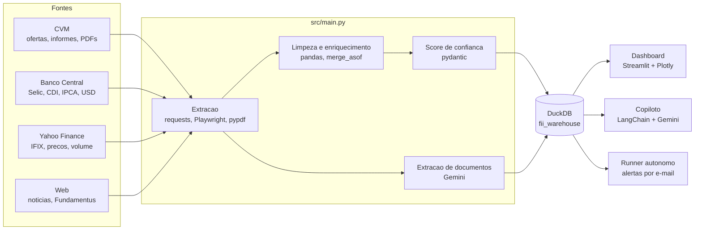

# FII Offer Radar

[](https://github.com/Isaacpk1/fii-offer-radar/actions/workflows/ci.yml)


**Pipeline de dados, warehouse analitico e agente de IA para triagem de ofertas primarias de Fundos Imobiliarios (FIIs) registradas na CVM (Resolucao 160).**

Toda semana surgem novas ofertas de cotas de FIIs, e avaliar cada uma exige cruzar o preco de emissao com o valor patrimonial, o preco na B3, a liquidez, o historico do emissor, o cenario macro e o que esta escrito no prospecto. Este projeto automatiza essa coleta e entrega, para cada oferta, um **score de priorizacao** e um **score de confianca auditavel** (quais dados existem, quais faltam e quais sinais se contradizem), alem de um copiloto que responde perguntas sobre o warehouse.

**▶ [Abrir a demo ao vivo](https://fii-offer-radar-kjrtjvayjttws5ycdh6euu.streamlit.app/)** · Streamlit Community Cloud

A demo usa um snapshot da base, regerado toda segunda-feira por um [workflow do GitHub Actions](.github/workflows/demo-snapshot.yml). O Copiloto fica desligado na demo publica porque exige chave do Gemini; as outras abas funcionam com os dados reais da CVM e do Banco Central.

> Ferramenta de apoio a triagem. Nao e recomendacao de investimento.

## Destaques

- **5 fontes de dados integradas**: CVM (ofertas, informes mensais e documentos), Banco Central (Selic, CDI, IPCA, cambio), Yahoo Finance (IFIX, precos e volume), Fundamentus (CNPJ para ticker) e noticias via Playwright.
- **Extracao de PDFs com LLM**: baixa prospectos e relatorios, extrai texto com `pypdf` e usa Gemini para encontrar DY projetado, taxas e indexadores, com nivel de confianca por campo.
- **Warehouse DuckDB** modelado por dominio (ofertas, informes, mercado, documentos, inteligencia, qualidade), com relatorio de cobertura de dados por tabela e coluna.
- **Score de confianca explicavel** (0 a 100), dividido em dados (40), sinais (35) e contexto (25), com resumo em texto do porque de cada nota.
- **Copiloto LangChain + Gemini** com tools de ranking, tese da oferta, macro, noticias, qualidade e registro de decisao do analista.
- **Runner autonomo** agendavel (cron ou Agendador de Tarefas) que roda o agente sobre o warehouse, salva os alertas e envia os urgentes por e-mail.
- **Dashboard Streamlit** com 7 abas: Tese da Oferta, Mercado, Ofertas, Suporte FII, Qualidade, Tabelas e Copiloto.

## Arquitetura



O diagrama detalhado esta em [`docs/pipeline.puml`](docs/pipeline.puml).

## Stack

| Area | Tecnologias |
| --- | --- |
| Dados | Python 3.11+, pandas, numpy, DuckDB, SQL |
| Coleta | requests, Playwright, yfinance, python-bcb, pypdf |
| IA | LangChain, Google Gemini, Pydantic |
| Interface | Streamlit, Plotly, streamlit-aggrid |
| Qualidade | pytest, ruff, GitHub Actions |

## Como rodar

```bash
git clone https://github.com/Isaacpk1/fii-offer-radar.git
cd fii-offer-radar

python -m venv .venv
source .venv/bin/activate        # Windows: .venv\Scripts\activate
pip install -r requirements.txt
pip install -e .
playwright install chromium

cp .env.example .env             # preencha GOOGLE_API_KEY
```

| O que | Comando |
| --- | --- |
| Pipeline completo | `python src/main.py` |
| Forcar nova coleta | `python src/main.py --force` |
| Reconstruir so o warehouse | `python src/database/build_database.py` |
| Coletar noticias | `python -m data_extraction.news.news_aggregator` |
| Dashboard | `streamlit run src/frontend/app.py` |
| Runner autonomo | `python src/ai_core/autonomous_runner.py --send-email` |
| Runner em loop | `python src/ai_core/autonomous_runner.py --loop --interval-minutes 1440 --send-email` |

Para agendar o runner no Linux:

```cron
0 7 * * 1-5 cd /caminho/fii-offer-radar && .venv/bin/python src/ai_core/autonomous_runner.py --send-email
```

No Windows, use o Agendador de Tarefas apontando para `.venv\Scripts\python.exe` com o argumento `src/ai_core/autonomous_runner.py --send-email`.

## Testes

```bash
pip install -r requirements-dev.txt
pytest
ruff check src tests
```

Os testes cobrem o score de confianca, a normalizacao e os filtros dos dados da CVM e os formatadores do dashboard. O CI roda ruff e pytest a cada push.

## Fluxo do pipeline

1. Baixa ofertas CVM 160, macro do BCB e IFIX.
2. Baixa o informe mensal de FIIs do ano atual.
3. Coleta noticias (best effort) via Playwright.
4. Limpa e filtra ofertas primarias de cotas de FII.
5. Enriquece cada oferta com macro e IFIX da data da oferta.
6. Verifica mudancas de status.
7. Mapeia ticker por CNPJ e busca dados de mercado da B3 quando possivel.
8. Consolida documentos, DY projetado e historico, score e confianca.
9. Gera `src/data/processed/fii_warehouse.duckdb`.

## Principais Tabelas

| Tabela | Uso |
| --- | --- |
| `ofertas_cvm` | Ofertas primarias, status, volumes, coordenadores e macro. |
| `dim_fii` | Cadastro consolidado por CNPJ/ticker. |
| `fii_informe_mensal` | VP/C, PL, cotistas e dados operacionais quando disponiveis. |
| `fii_cotacoes` | Preco e liquidez para tickers mapeados. |
| `fii_metricas` | Suporte do fundo para a tese da oferta. |
| `oferta_projecoes` | DY projetado/historico e fontes documentais. |
| `oferta_inteligencia` | Tese final por processo CVM. |
| `noticias_fiis` | Noticias coletadas para contexto qualitativo. |
| `data_quality_report` | Cobertura de dados por tabela/coluna. |

## Limites Importantes

- Preco B3, P/VP de mercado e liquidez so existem quando o ticker foi mapeado e a coleta de mercado funcionou.
- Fundos sem B3 ainda podem ter dados uteis: VP/C, patrimonio, cotistas, rendimento historico e historico de ofertas.
- DY projetado e dado prospectivo do emissor/documento de oferta, nao dado auditado.
- Noticias sao contexto qualitativo best effort; sites podem bloquear scraping ou mudar layout.
- O runner autonomo e manual/agendavel; nao roda como servico continuo por padrao.
- `yfinance` atende prototipo/triagem, mas nao substitui fonte institucional de mercado.

## Estrutura De Pastas

```text
.
|-- .github/workflows/ci.yml
|-- docs/
|   |-- DATABASE.md
|   |-- FILE_INVENTORY.md
|   `-- PRODUCT_SCOPE.md
|-- src/
|   |-- main.py
|   |-- ai_core/
|   |   |-- agent.py
|   |   |-- autonomous_runner.py
|   |   |-- macro.py
|   |   |-- schemas.py
|   |   |-- tool_config.py
|   |   |-- tools.py
|   |   |-- tools_confidence.py
|   |   |-- tools_ranking.py
|   |   |-- tools_read.py
|   |   |-- tools_write.py
|   |   `-- warehouse.py
|   |-- data/
|   |   |-- raw/
|   |   |-- processed/
|   |   |-- alertas_autonomos/
|   |   `-- briefs/
|   |-- data_extraction/
|   |   |-- cvm_extractor.py
|   |   |-- fii_informe_extractor.py
|   |   |-- fii_market_extractor.py
|   |   |-- fii_ticker_mapper.py
|   |   |-- macro_extractor.py
|   |   |-- status_monitor.py
|   |   |-- oferta_document_*.py
|   |   `-- news/
|   |       |-- b3_news.py
|   |       |-- base_scraper.py
|   |       |-- funds_explorer.py
|   |       |-- infomoney.py
|   |       |-- news_aggregator.py
|   |       `-- valor_economico.py
|   |-- data_processing/
|   |   |-- cleaner.py
|   |   |-- confidence_scorer.py
|   |   |-- enricher.py
|   |   `-- utils.py
|   |-- database/
|   |   |-- schema.sql
|   |   |-- build_common.py
|   |   |-- build_database.py
|   |   |-- builders.py
|   |   |-- *_builders.py
|   |   `-- quality.py
|   `-- frontend/
|       |-- app.py
|       |-- agent_session.py
|       |-- components.py
|       |-- config.py
|       |-- data.py
|       |-- formatters.py
|       |-- styles.py
|       |-- view_utils.py
|       |-- views.py
|       `-- views_*.py
|-- tests/
|-- pyproject.toml
|-- requirements.txt
`-- README.md
```

`src/data/` contem artefatos gerados localmente e fica fora do git.

## Exemplo DuckDB

```python
import duckdb

con = duckdb.connect("src/data/processed/fii_warehouse.duckdb")
df = con.execute("""
    SELECT numero_processo, ticker, nome_emissor, preco_emissao,
           valor_cota_vpc, p_vp_emissao, preco_cota_b3,
           desconto_vs_b3, confianca_total, score_priorizacao
    FROM oferta_inteligencia
    ORDER BY score_priorizacao DESC NULLS LAST
    LIMIT 20
""").df()
```

## Documentacao

- [`docs/DATABASE.md`](docs/DATABASE.md): warehouse, tabelas e cobertura.
- [`docs/PRODUCT_SCOPE.md`](docs/PRODUCT_SCOPE.md): escopo do produto, limites e funcionalidades.
- [`docs/FILE_INVENTORY.md`](docs/FILE_INVENTORY.md): inventario de arquivos.

## Manutencao

- Pare o Streamlit antes de reconstruir o DuckDB se houver lock de arquivo.
- Rode `src/database/build_database.py` quando schema ou builders mudarem.
- Use `src/main.py --force` quando quiser atualizar fontes externas.
- Reinstale browsers com `playwright install chromium` se os scrapers de noticias falharem por browser ausente.
- O agente executa codigo Pandas via LangChain com `allow_dangerous_code=True`; use em ambiente controlado.

## Autor

**Isaac Nicolas Alves da Silva** · [LinkedIn](https://www.linkedin.com/in/isaac-nicolas-alves-da-silva-9787592a4/) · [GitHub](https://github.com/Isaacpk1)

Licenca [MIT](LICENSE).
